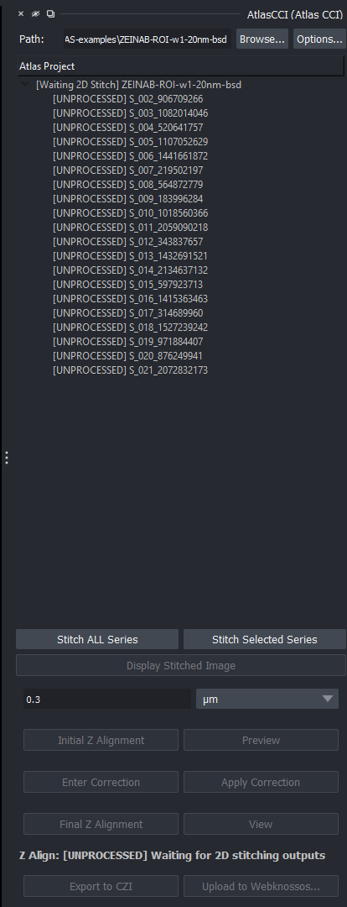
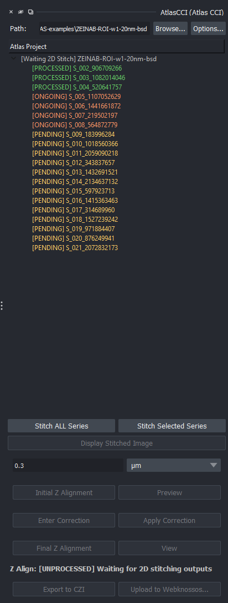
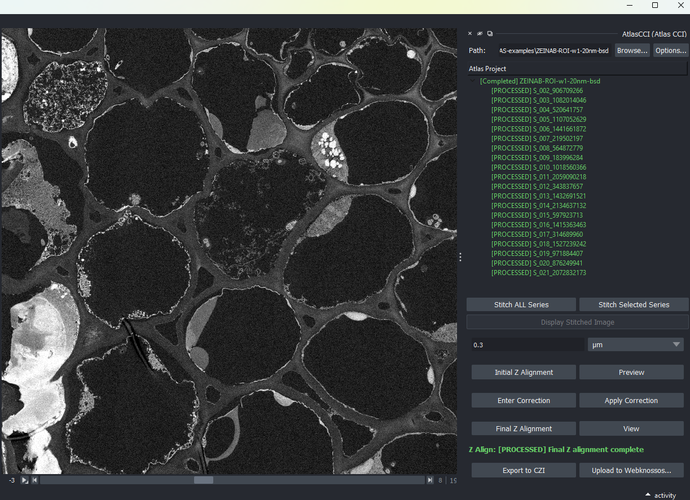
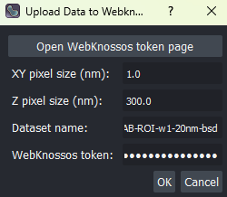

# napari atlas cci

Napari plugin to give a GUI interface to the cci atlas tool.

This is a wrapper around the [cci atlas](https://github.com/CCI-GU-Sweden/ATLAS) package.

## Installation

A standalone version of napari is available at [napari.org](https://napari.org/dev/tutorials/fundamentals/installation_bundle_conda.html), and the plugin is available on the [napari hub](https://napari-hub.org/plugins/napari-omero-downloader-cci.html). Just follow the installation instruction from napari. You can install the plugin from the plugin manager.

It is also possible to install the plugin from [source code](https://github.com/CCI-GU-Sweden/napari-atlas-cci) or from pip with `pip install napari-atlas-cci`. In this case, be sure to isolate the installation in a dedicated environment with napari.

## How to use

Browse and load an atlas project. An atlas project is composed of a series of S_ folder, each containing 1 or multiple tiff images.

### 2D stitching

For 2D stitching, it is possible to process one, multiple or all S_ folder. This will stitch images in a S_ folder in one tiff image. The number of images being processes at the same time is dependent to the number of core in your PC. Be carefull on RAM consumption.

After processing, you can select one S_ folder and display the image in Napari.

### Z alignement

It is only possible to process to the z-alignement if all S_ folder has been stitched.
The alignement is required to run first a on downsampled image. This downsampling factor can be control in the Options.

Once the initial alignement is completed, a preview image is display. Please confirm that the alignement is correct through the z volume.

To adjust alignment, choose a correction mode and click **Enter Correction**.
The default, **Trace: one point per plane**, creates a single **Reference Points**
layer. Follow the same feature through consecutive Z planes, placing one point
per plane, consistently forward or backward. Points are used in the order you
enter them: `[P0, P1, P2]` creates the pairs `P0 → P1` and `P1 → P2`.

A gap in Z starts a separate trace. For example, points on planes
`[2, 3, 4, 8, 9, 10]` create four pairs, never a pair from plane 4 to plane 8.
Each trace needs at least two points. There can be only one reference point per
plane across all traces. Duplicate planes, isolated points, and invalid ordering
are rejected before correction starts; edit the points and try again.

For the original workflow, choose **Explicit point pairs**. This creates
**Reference Points** and **Adjustable Points**. Place matching landmarks in the
same order in both layers, with each reference point one Z slice before its
adjustable point. Both layers must contain the same number of points. The mode
selector determines which workflow is used; tracing ignores any existing
Adjustable Points layer.

Once done, click on the "Apply correction" button. It will reprocess the downsample image, then display the corrected zstack. Check that the correction happen.

WIP: Small video Youtube to display alignement correction.

Once the data is aligned, it can be processed for the "Final Z Alignement". This step can be time consuming based on the size of the dataset, so please, be patient.

### Options and saved preferences

The **Options...** dialog includes lower and upper saturation percentiles for
alignment processing. Defaults are **1.0** and **99.95**; values must satisfy
`0 ≤ lower < upper ≤ 100`. They apply to saved previews, previews regenerated
after manual correction, and full-resolution aligned outputs. Changing them
does not modify outputs that have already been generated.

Click **OK** to apply and save the Options values; **Cancel** leaves them
unchanged. Thread count, maximum stitching shift, alignment downsampling,
CZI compression, and both percentiles are restored next time the plugin opens.
Axial pixel size and its explicit unit are also saved when the edit is finished
or the unit changes. Thread count is limited to one fewer than the available CPU
cores (with a minimum of one).

Preferences are saved as readable JSON in
`<Qt GenericConfigLocation>/napari-atlas-cci/settings.json`, under the user's
AppData directory on Windows. They apply across projects on that computer.
Missing preferences use the defaults; invalid files produce feedback and fall
back to defaults. Upload tokens and project paths are excluded. This implements
local user preferences alongside [#12](https://github.com/CCI-GU-Sweden/napari-atlas-cci/issues/12);
portable project configurations and historical run snapshots described in
[#14](https://github.com/CCI-GU-Sweden/napari-atlas-cci/issues/14) remain separate work.

### Export and upload

All intermediate files are stored in the root folder of the Atlas project. Individual planes are stored as tiff images, will the alignement is stored as a pickle pandas table. The z aligned files (both the downsample and the final ones) are saved in a ome-zarr format.

For easier data manipulation, it is possible to export the final alignement as a czi file. The other option is to upload the data on [Webknossos](https://webknossos.org/), which is great for both visualization and fine z-alignement. To do this upload, it is required to have a account on webknossos and to indicate your token for the upload.

## Troubleshooting

## Contributing

Contributions are very welcome. Tests can be run with [tox], please ensure
the coverage at least stays the same before you submit a pull request.
