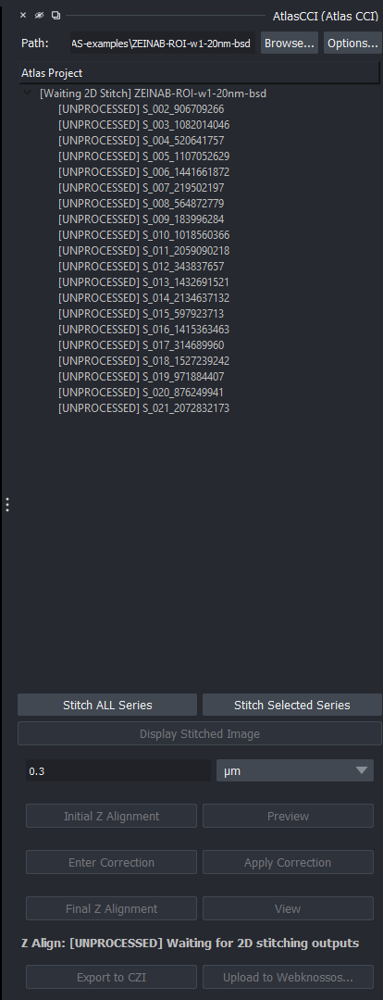
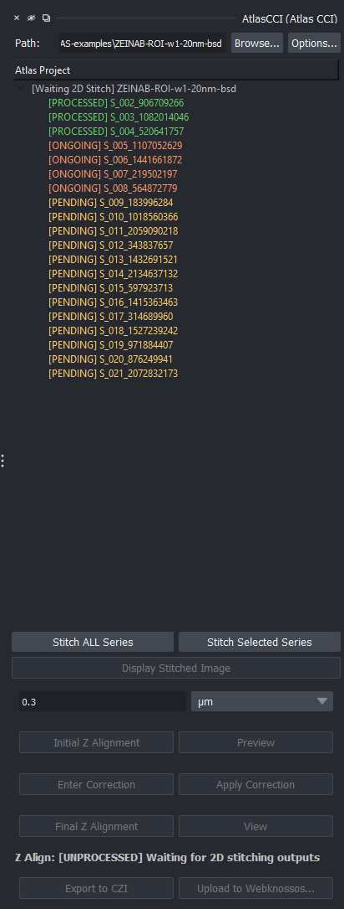
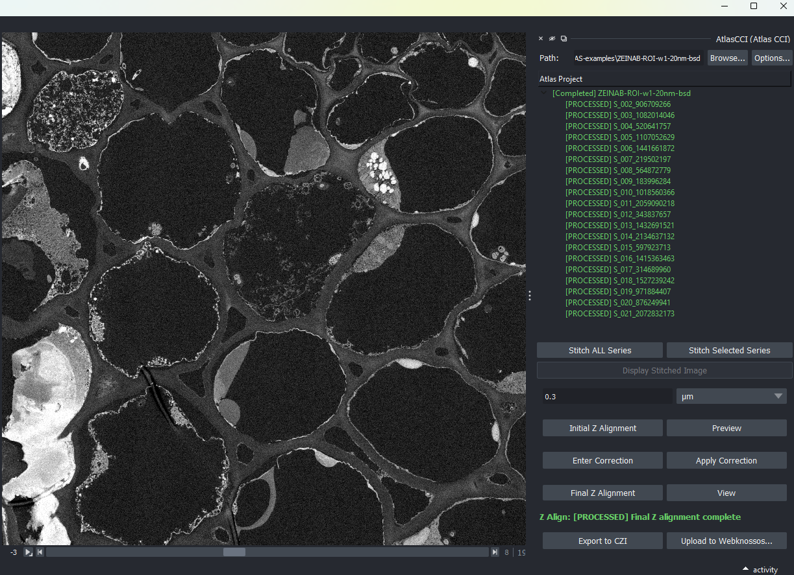
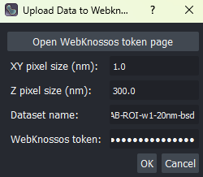

# napari atlas cci

A napari plugin for stitching and aligning array tomography data acquired with
FIBICS ATLAS. It provides a graphical interface to the
[CCI ATLAS backend](https://github.com/CCI-GU-Sweden/ATLAS).

The workflow has been tested primarily with data acquired on the Zeiss Gemini
SEM 450 at the Centre for Cellular Imaging (CCI), University of Gothenburg.
See [CCI's correlative array tomography page](https://www.gu.se/index.php/en/core-facilities/core-facilities-research-infrastructures/centre-for-cellular-imaging-cci/our-services/correlative-array-tomography)
for details of the workflow and equipment.

## Installation

The plugin requires Python **3.11 or 3.12**, napari, and a Qt backend. Its
[ATLAS backend](https://github.com/CCI-GU-Sweden/ATLAS) is installed as a
Python dependency; the master Zarr workflow requires `atlas-cci-align` 1.3.19
or later.

### Create an environment

Install [Miniforge](https://github.com/conda-forge/miniforge) or another Conda
distribution, then run the following in a terminal (on Windows, use a Conda
terminal):

```bash
conda create -n atlas-napari -c conda-forge python=3.11 napari pyqt
conda activate atlas-napari
python -m pip install napari-atlas-cci
napari
```

In napari, open **Plugins → Atlas CCI → AtlasCCI**. To start it again later,
activate the environment and run `napari`. For more ways to install napari, see
the [napari installation guide](https://napari.org/stable/tutorials/fundamentals/installation.html).

### Create a desktop launcher

These launchers open a terminal, activate the environment, and start napari.
Keep the terminal open while napari runs; it also shows progress and errors.
Replace `atlas-napari` below if you chose a different environment name.

#### Windows

1. Open your Conda terminal and run `conda info --base`. Note the path it
   prints, for example `C:\Users\YourName\miniforge3`.
2. Open Notepad and paste the following. Replace the example path with your
   own Conda base path, keeping `\condabin\conda.bat` at the end:

   ```bat
   @echo off
   call "C:\Users\YourName\miniforge3\condabin\conda.bat" activate atlas-napari
   if errorlevel 1 (
       echo Could not activate the atlas-napari environment.
       pause
       exit /b 1
   )
   napari
   pause
   ```

3. Choose **Save As**, select **All Files** as the file type, and save it on
   the desktop as `Launch Atlas Napari.bat` (not `.bat.txt`). Double-click it
   to start napari. The terminal stays open after napari closes so you can read
   any messages; press a key to close it.

#### macOS

1. Open Terminal and run `conda info --base`. Note the path it prints, for
   example `/Users/yourname/miniforge3`.
2. Open TextEdit, choose **Format → Make Plain Text**, and paste the following.
   Replace the example path with your own Conda base path, keeping
   `/etc/profile.d/conda.sh` at the end:

   ```bash
   #!/bin/bash
   source "/Users/yourname/miniforge3/etc/profile.d/conda.sh" || exit 1
   conda activate atlas-napari || exit 1
   napari
   ```

3. Save the plain-text file on the desktop as `Launch Atlas Napari.command`.
   In Terminal, make it executable once:

   ```bash
   chmod +x ~/Desktop/"Launch Atlas Napari.command"
   ```

   Double-click the file to open Terminal and start napari. If your Desktop is
   stored in another location, use that file's path in the `chmod` command.
   See [Apple's instructions for executable scripts](https://support.apple.com/guide/terminal/apdd100908f/mac).

### Update an existing environment

Close napari, activate the environment in which you installed the plugin, and
update both the plugin and the ATLAS backend:

```bash
conda activate atlas-napari
python -m pip install --upgrade napari-atlas-cci atlas-cci-align
```

Run `napari` again. To inspect the installed versions and their locations:

```bash
python -m pip show napari-atlas-cci atlas-cci-align
```

Published packages can lag behind changes merged on GitHub. An editable source
installation uses its local checkout, so check its location before replacing it
with a PyPI installation.

### Install from source for development

After creating and activating the environment above, clone this repository and
install it in editable mode:

```bash
git clone https://github.com/CCI-GU-Sweden/napari-atlas-cci.git
cd napari-atlas-cci
python -m pip install -e ".[testing]"
```

Restart napari after changing plugin code. The ATLAS backend is installed from
PyPI unless it has separately been installed from a local editable checkout.

## How to use

### Select the ATLAS section-set folder

Use **Browse...** to select the ATLAS **section set** folder: the folder that
contains the `S_...` section folders directly. Select the section-set folder,
not an individual `S_...` folder or the higher-level session folder. For
example:

```text
session_740977233/
└── Section Set 6/                         ← select this folder
    ├── S_012_1314243284/                 ← one section
    │   ├── MosaicInfo_S_012_1314243284.ve-mif
    │   └── Tile_r1-c1_S_012_1314243284.tif
    └── S_013_1234567890/
        ├── MosaicInfo_S_013_1234567890.ve-mif
        ├── Tile_r1-c1_S_013_1234567890.tif
        └── Tile_r2-c1_S_013_1234567890.tif
```

Names and numbers vary between acquisitions. An S folder represents one
section and may contain one tile or several tiles. For stitching, each section
folder needs one `.ve-mif` acquisition metadata file and the `.tif` tiles
listed in it. The acquisition must be marked completed in the metadata, and
the tile names and count must match the files present. ATLAS may also create
other files or subfolders, such as overview images and update files.

The plugin lists valid S folders found directly inside the selected section
set. If a section is missing from the list, check that its acquisition is
complete and that its metadata and tiles are present. The plugin writes the
master `stitched_sections.zarr` and alignment outputs alongside the S folders
in the selected section-set folder.



### 2D stitching

For 2D stitching, select one, multiple, or all S_ folders. Stitched sections and their metadata are stored in `stitched_sections.zarr` in the project folder. The thread count in Options controls how many sections can be stitched concurrently; higher counts require more memory.



After processing, you can select one S_ folder and display the image in Napari.

### Z alignment

Initial Z alignment uses completed sections in the master Zarr, in numeric
section order or in the order specified by `correct_order.txt`. Set the axial
pixel size and unit, then click **Initial Z alignment**. The plugin calculates
shifts and displays a downsampled preview; the downsampling factor is set in
**Options...**. Scroll through the Z planes and inspect the alignment.


#### Choose the section order

By default, initial alignment uses all completed sections in ascending ATLAS
section-number order. If a section number is missing, the backend prints a
warning in the terminal and treats the gap as accepted: for example, it aligns
`S_4` directly with `S_6` if `S_5` is missing. Inspect such warnings to confirm
the gap is expected.

To select a subset or change the order, create a plain-text file named
`correct_order.txt` in the selected section-set folder before running
**Initial Z alignment**.

Write ATLAS section numbers as comma-separated integers, without the `S_`
prefix. The order in the file is the alignment order. For example:

```text
1,...,3,6,9,...,7
```

This selects sections `S_1, S_2, S_3, S_6, S_9, S_8, S_7`, in that order.
The `...` token expands the range between the two numbers, including both
ends; it works in ascending or descending order. Sections not listed are
excluded. Every section listed or included in a range must already be complete
in the master Zarr; otherwise initial alignment reports an error. To include a
range with missing section numbers, list only the available sections instead.

#### Correct the alignment by tracing

The default mode, **Trace: one point per plane**, lets you follow the same
recognizable feature through successive sections. The plugin turns consecutive
points into pairs automatically, so you only need one points layer.

1. Select **Trace: one point per plane** and click **Enter Correction**. The
   plugin creates a red **Reference Points** layer and selects it for adding
   points.
2. On the preview, find a feature that is visible in consecutive Z planes.
   Place a point on that feature in the first plane, move to the adjacent plane,
   and place a point on the same feature. Continue in the same direction,
   placing **one point per plane**. You can trace forwards or backwards.
3. Click **Apply Correction**. The plugin calculates the correction and
   rebuilds the preview. Inspect the new preview by scrolling through the
   corrected planes.
4. If further adjustment is needed, click **Enter Correction** again and place
   **new points on the updated preview**. Repeat as needed. The correction is
   added to the existing alignment, so reusing old points would apply the same
   adjustment again.

For example, points entered on planes `2, 3, 4` create pairs `2 → 3` and
`3 → 4`. A gap starts a separate trace: `2, 3, 4, 8, 9, 10` creates pairs
`2 → 3`, `3 → 4`, `8 → 9`, and `9 → 10`; it does not join planes 4 and 8.
Each trace needs at least two consecutive planes. Enter each trace in order,
with at most one point per plane across all traces. The plugin reports duplicate
planes, isolated points, and invalid ordering so you can edit the points and
try again.

The original automatic alignment is saved as
`alignment_results/z_alignment_results_before_manual_correction.pkl`. The
latest corrected results are saved in `z_alignment_results.pkl` and used for
final alignment.

#### Alternative: explicit point pairs

For the earlier two-layer workflow, select **Explicit point pairs** and click
**Enter Correction**. The plugin creates red **Reference Points** and blue
**Adjustable Points** layers. Add matching landmarks in the same order to both
layers: each reference point belongs to the Z plane immediately before its
matching adjustable point. Both layers must contain the same number of points.
Click **Apply Correction** and inspect the regenerated preview. In trace mode,
any existing Adjustable Points layer is ignored.

When satisfied with the preview, click **Final Z Alignment** to generate the
full-resolution output. This can take time for large datasets.



### Options and saved preferences

The **Options...** dialog includes lower and upper saturation percentiles for
alignment processing. Defaults are **1.0** and **99.95**; values must satisfy
`0 ≤ lower < upper ≤ 100`. They apply to saved previews, previews regenerated
after manual correction, and full-resolution aligned outputs. Changing them
does not modify outputs that have already been generated.

When the plugin creates an aligned preview or full-resolution output, it
stretches each section's intensity range using its own selected percentiles.
This improves contrast and can make neighboring sections look more consistent.
Values outside the stretched range are clipped to the image data type's limits.
**This changes the saved pixel intensities relative to the original stitched
and raw images**; it is not just a display setting. Use the original stitched
sections in `stitched_sections.zarr` when unmodified stitched intensities are
needed for quantitative analysis.

Click **OK** to apply and save the Options values; **Cancel** leaves them
unchanged. Thread count, maximum stitching shift, alignment downsampling,
CZI compression, and both percentiles are restored next time the plugin opens.
Axial pixel size and its explicit unit are also saved when the edit is finished
or the unit changes. Thread count is limited to one fewer than the available CPU
cores (with a minimum of one).

Preferences are saved as readable JSON in
`<Qt GenericConfigLocation>/napari-atlas-cci/settings.json`, under the user's
AppData directory on Windows. They apply across projects on that computer.
Missing preferences use the defaults; invalid files produce feedback and fall
back to defaults. Upload tokens and project paths are excluded from this JSON
file. The Browse dialog remembers the last selected project folder separately
using Qt settings. This implements local user preferences alongside [#12](https://github.com/CCI-GU-Sweden/napari-atlas-cci/issues/12);
portable project configurations and historical run snapshots described in
[#14](https://github.com/CCI-GU-Sweden/napari-atlas-cci/issues/14) remain separate work.

### Export and upload

Stitched sections and their metadata are stored in `stitched_sections.zarr` in
the project folder. Alignment results are saved as a pandas pickle table in
`alignment_results`. After **Final Z Alignment**, the plugin also provides the
following outputs. The aligned arrays and exports derived from them contain
the percentile-stretched intensities described in **Options and saved
preferences** above.

**Disk space and time:** The current workflow creates several copies of the
image data for convenient viewing and export. Final alignment writes both a
full-resolution aligned Zarr and an OME-Zarr pyramid. A WebKnossos upload also
builds a local WebKnossos dataset and pyramid before uploading it; that local
dataset is deleted after a successful upload by default. Allow sufficient free
space and processing time, especially for large projects. We may review and
reduce these intermediate copies in a future version.

#### OME-Zarr

The plugin automatically creates an OME-Zarr pyramid for the downsampled
preview and another for the full-resolution alignment. The final pyramid is
saved as `<project>_aligned.ome.zarr` in the project folder. Use **View** next
to **Final Z Alignment** in the plugin or open the OME-Zarr folder with a
compatible viewer.
The pyramid contains multiple resolutions and carries the ATLAS alignment
metadata. A separate full-resolution aligned Zarr array,
`<project>_aligned.zarr`, is also saved and is used as the source for CZI and
WebKnossos export.

#### CZI

Click **Export to CZI** after final alignment to write
`<project>_aligned.czi` in the project folder. The plugin reads the aligned
Zarr one plane at a time and writes tiled CZI data. XY pixel size comes from
the master store and Z pixel size from the axial value and unit in the UI;
check the axial value before exporting. CZI compression can be set in
**Options...**. The CZI export currently writes image data and scale; retaining
the complete alignment transform metadata is being investigated in
[#20](https://github.com/CCI-GU-Sweden/napari-atlas-cci/issues/20).

#### WebKnossos

Click **Upload to Webknossos...** after final alignment. Enter your
[WebKnossos](https://webknossos.org/) token, review the dataset name and XY/Z
pixel sizes, and start the upload. The dialog displays the name that will be
used and lets you edit it. XY size is read from the master store; Z size comes
from the axial value and unit in the UI. Sizes in the upload dialog are in
nanometers.

The plugin builds a local compressed WebKnossos dataset and its resolution
pyramid before uploading. By default, the local WebKnossos dataset is deleted
after a successful upload; clear the checkbox to keep it. The aligned Zarr
and OME-Zarr remain in the project folder. A successful upload displays a link
to the dataset. An account and token are required; tokens are not saved in
plugin preferences.




#### Download from WebKnossos

After fine alignment in WebKnossos, use **Download from webknossos...** at the
bottom of the plugin. Enter your token, the new aligned dataset's ID or full
dataset URL, an output filename, and the destination folder (defaults to the
current project). No local aligned output is required to use this button.

The download reads the full-resolution `color` layer one Z plane at a time and
writes that plane as CZI tiles of at most 1024 × 1024 pixels. All channels are
preserved, XY axes are converted to CZI order, and voxel sizes are copied from
the remote dataset. Source bounding-box offsets are rebased to CZI coordinates
starting at zero. CZI compression follows **Options...** at download start.
An existing destination file is never overwritten; choose a new filename.
If a transfer fails after writing starts, a partial CZI may remain at that path.

Downloads run in a background worker, with an activity indicator and
completion or error notifications. Tokens are used for the request and are not
saved in preferences.

## Why translation-only alignment?

This alignment applies XY translations between sections. It does not apply
rotation, scaling, or other affine transforms at this stage. Placing the
full-resolution sections using pixel shifts avoids the interpolation that those
transforms would require and keeps the original pixel spacing. The preview is
downsampled, and aligned outputs have their intensities stretched as described
in **Options and saved preferences** above, so their pixel values differ from
the raw data. The translated volume can be used as a starting point for finer
alignment in other tools, for example:

- [WebKnossos AI Alignment](https://docs.webknossos.org/webknossos/automation/alignment.html),
  which aligns sections after upload. See its documentation for dataset and
  service requirements.
- [Microscopy Image Browser (MIB) alignment](https://mib.helsinki.fi/help/main2/user-interface/menu/dataset/dataset-alignment.html),
  part of the open-source MATLAB-based image analysis software.
- [TrakEM2 in Fiji](https://imagej.github.io/plugins/trakem2/tutorials), which
  includes tools for aligning serial sections.

Check the chosen tool's supported input formats and import instructions before
starting.

## Troubleshooting

- **Plugin not visible:** check that napari was launched from the environment
  where `napari-atlas-cci` is installed. Run
  `python -m pip show napari-atlas-cci` in that environment and restart napari.
- **Qt cannot load the `xcb` platform plugin on Linux:** check your desktop and
  Qt runtime setup using the [napari installation guide](https://napari.org/stable/tutorials/fundamentals/installation.html).
  When using WSL, also confirm that Linux GUI applications work in your WSL setup.
- **WebKnossos upload:** provide an account token in the upload dialog. The
  token is not saved in plugin preferences.

## Contributing

Contributions are welcome. Install the source with the `testing` extra as
shown above, then run:

```bash
python -m pytest
```
